<!-- ⛩️ Header ⛩️ -->

  

  
  
  
  
  

---

## ⛩️ About Me

- 🎓 **Computer Engineer**, graduated from **NUST, Pakistan**
- 🔬 Currently working with **Dr. Sagheer Khan (KFUPM)** on **IoT, IoMT and Digital Twins in Healthcare**
- 📡 I teach machines to sense people through **invisible WiFi signals (CSI)**, with no cameras and no wearables
- 🧠 Main interests: **AI • Machine Learning • IoT • Wireless Sensing • Edge Intelligence**
- 📄 First-author paper **PiSense** published in *Computing* (Springer, 2026)
- ⚔️ Motto: *Turn invisible signals into intelligent decisions*
- 💬 Always happy to talk research. Let's build something great together!

 

---

## 📜 Publications

| | Title | Venue |
|:-:|---|---|
| 📄 | [**PiSense: A Raspberry Pi-Based Real-Time Occupancy Detection System Using CSI from Commodity WiFi**](https://link.springer.com/article/10.1007/s00607-026-01751-9) | *Computing* (Springer), 2026 |
| 🗂️ | [**CSI Dataset for WiFi Based Human Detection**](https://ieee-dataport.org/documents/csi-dataset-wifi-based-human-detection) | IEEE DataPort, 2025 |

---

## 🗡️ Featured Projects

  
  
  
  

---

## ⚔️ Arsenal

  

  
  
  
  
  
  
  
  

---

## 🌒 GitHub Stats

  
  

  

  <picture>
    <source media="(prefers-color-scheme: dark)" srcset="https://raw.githubusercontent.com/qzaman243/qzaman243/output/github-snake-dark.svg" />
    <source media="(prefers-color-scheme: light)" srcset="https://raw.githubusercontent.com/qzaman243/qzaman243/output/github-snake.svg" />
    
  </picture>

---

<i>⚔️ Off the keyboard: books on history, quantum physics & religion 📚 • meditation 🧘 • gym 🏋️ • cricket 🏏 • pull-ups 🦾</i>

  

